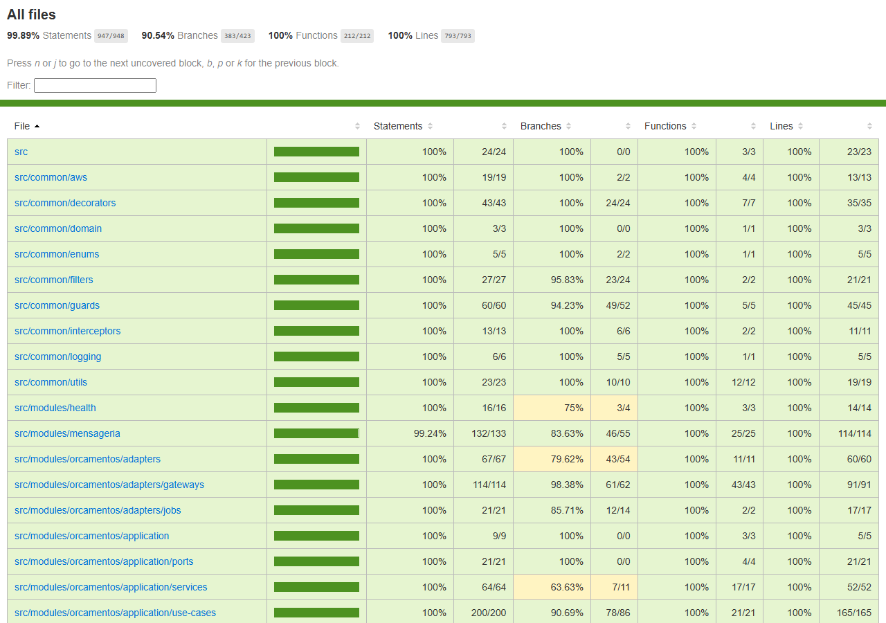

# tc-oficina-billing-service — Serviço de Orçamento e Pagamento

[](https://github.com/FIAP-POS-TECH-SOFTWARE-ARCHITECTURE/tc-oficina-billing-service/actions/workflows/ci.yml)

Serviço de orçamento e pagamento da oficina mecânica — Tech Challenge FIAP SOAT, Fase 4, grupo
**Integradores**. API REST NestJS em Clean Architecture, com banco DynamoDB próprio, que
participa da **Saga** coordenada pelo `os-service`: recebe comandos por fila SQS, aplica a regra
no seu banco e responde com eventos no tópico SNS.

## Propósito ✱

Na Fase 4 o monólito da Fase 3 foi dividido em três microsserviços (`os-service`,
`billing-service`, `execution-service`), cada um com o seu banco. O `billing-service` é dono de:

- **orçamento**: gera o orçamento a partir do comando `GerarOrcamento` (validando que o total é a
  soma dos itens) e expõe ao cliente a consulta, a aprovação e a rejeição;
- **pagamento**: na aprovação, cria a cobrança e devolve o `linkPagamento` ao cliente; no estorno,
  chama o provedor com chave de idempotência;
- **compensações**: cancela o orçamento (`CancelarOrcamento`) e estorna o pagamento
  (`EstornarPagamento`) quando o orquestrador desfaz o fluxo.

**Papel na Saga:** participante. O fluxo da OS segue o **Saga Pattern** na variante orquestrada:
quem decide o próximo passo e as compensações é o orquestrador, que fica no `os-service` (no
código, módulo `orquestracao-os`, com o estado em `FluxoOrdemServico` e o coordenador
`OrquestradorOrdemServico`). O billing não tem lógica de orquestração e não conhece o
`execution-service`: recebe comandos e publica eventos.

**Pagamento.** Hoje o provedor é um adapter simulado (`gateway-pagamento.simulado.ts`) atrás da
porta `GatewayPagamentoPort`. O Mercado Pago é o adapter-alvo da mesma porta
([ADR-013](https://github.com/FIAP-POS-TECH-SOFTWARE-ARCHITECTURE/tc-oficina-os-service/blob/main/docs/arquitetura/adrs/adr-013-pagamento-antes-do-reparo-mercado-pago.md));
por isso ainda não há controller de webhook de pagamento (detalhes em
[`docs/arquitetura.md`](docs/arquitetura.md)).

A aplicação roda atrás do **API Gateway HTTP API** (rotas com o prefixo `/billing`) em dois
ambientes, `homolog` e `prod`, separados por namespace no EKS, e emite telemetria para o New
Relic (APM, logs estruturados e rastreamento distribuído entre os serviços).

## Tecnologias ✱

| Camada | Tecnologia |
| --- | --- |
| Runtime | Node.js 25 (imagem `node:25-alpine`) + TypeScript |
| Framework | NestJS 11 |
| Banco | Amazon DynamoDB, tabela única `oficina-billing-<env>` (chaves `pk`/`sk` e índice `gsi1`) |
| Acesso a dados | AWS SDK v3 (`@aws-sdk/lib-dynamodb`), escrita condicional por `versao` |
| Mensageria | Amazon SNS + SQS (AWS SDK v3), com outbox no próprio DynamoDB e idempotência por `messageId` |
| Contratos | JSON Schema (Ajv) em [`contratos/`](contratos/README.md), validados na publicação e no consumo |
| Auth | JWT HS256 (`@nestjs/jwt`): token de staff (papéis `ATENDENTE`, `ADMINISTRADOR`) e token de cliente emitido pela Lambda |
| Testes | Jest 30 + `jest-cucumber` (BDD) + Supertest + Testcontainers + MiniStack |
| Qualidade | SonarQube (quality gate com cobertura mínima de 80%) |
| Observabilidade | New Relic (APM + `nestjs-pino`) |
| Containers | Docker + Docker Compose |
| Orquestração | Kubernetes (EKS), Kustomize, HPA por CPU, rolling update |
| CI/CD | GitHub Actions |
| Emulador AWS local | MiniStack (SNS/SQS/DynamoDB) |

## Arquitetura deste repositório ✱

Documento completo, com componentes, rotas, máquina de estados do orçamento, modelo de dados no
DynamoDB, mensagens, idempotência e outbox: [`docs/arquitetura.md`](docs/arquitetura.md).
Contratos das mensagens: [`contratos/README.md`](contratos/README.md).

Visão da solução e decisão da Saga, no `os-service`:
[visão geral dos microsserviços](https://github.com/FIAP-POS-TECH-SOFTWARE-ARCHITECTURE/tc-oficina-os-service/blob/main/docs/arquitetura/visao-geral-microsservicos.md) e
[ADR-008 (Saga orquestrada)](https://github.com/FIAP-POS-TECH-SOFTWARE-ARCHITECTURE/tc-oficina-os-service/blob/main/docs/arquitetura/adrs/adr-008-saga-orquestrada.md).

### Saga Pattern — participação do billing

| Passo da Saga | Comando que o billing recebe | Efeito | Evento publicado |
| --- | --- | --- | --- |
| Gerar orçamento | `GerarOrcamento` | cria o orçamento em `AGUARDANDO_APROVACAO` | `OrcamentoGerado` / `FalhaGerarOrcamento` |
| Compensar: desfazer o orçamento | `CancelarOrcamento` | `AGUARDANDO_APROVACAO` ou `APROVADO` → `CANCELADO` | `OrcamentoCancelado` |
| Compensar: devolver o dinheiro | `EstornarPagamento` | `PAGO` → `ESTORNADO` (sem pagamento registrado, só reemite `PagamentoEstornado` com `pagamentoId` nulo) | `PagamentoEstornado` |

A aprovação e a rejeição acontecem por HTTP, pelo cliente, e viram os eventos `OrcamentoAprovado`
e `OrcamentoRejeitado`, que o orquestrador consome para avançar. O pagamento é o último passo
antes do reparo (contramedida de *visão pessimista* contra *dirty read*). Contra *lost update*,
o billing aplica a contramedida **rever/reler valor**: toda escrita no DynamoDB é condicional por
`versao`, então a aprovação do cliente que corre contra um `CancelarOrcamento` não sobrescreve a
outra. O consumo é idempotente por `messageId` e `CancelarOrcamento` que chega antes de
`GerarOrcamento` é tratado (o SQS Standard não garante ordem).

## Comunicação ✱

### Assíncrona (SNS/SQS)

Os nomes físicos levam o prefixo `oficina-<env>-` (`homolog`, `prod`, ou `local` no emulador) e a
fila tem uma DLQ `-dlq` (redrive na 5ª entrega). Catálogo completo de mensagens, schemas e regras
de idempotência: [`contratos/README.md`](contratos/README.md).

| Sentido | Recurso | Tipos de mensagem |
| --- | --- | --- |
| Consome (comando) | fila `oficina-<env>-billing-comandos` (origem `os`) | `GerarOrcamento`, `CancelarOrcamento`, `EstornarPagamento` |
| Produz (evento) | tópico SNS `oficina-<env>-eventos` (`origem: billing`) | `OrcamentoGerado`, `FalhaGerarOrcamento`, `OrcamentoAprovado`, `OrcamentoRejeitado`, `OrcamentoCancelado`, `PagamentoEstornado` |

`PagamentoConfirmado` e `EstornoFalhou` estão no catálogo do contrato, mas dependem do adapter do
Mercado Pago e ainda não são emitidos. Os eventos saem por um outbox gravado na mesma transação
do efeito, republicado por um job a cada 15 s se a publicação imediata falhar.

### Síncrona (REST)

| Rota | Quem chama | Auth |
| --- | --- | --- |
| `GET /billing/cliente/orcamentos/:numeroOs` | cliente dono da OS | token de cliente (CPF) |
| `POST /billing/cliente/orcamentos/:numeroOs/aprovar` | cliente dono da OS | token de cliente; `422` fora de `AGUARDANDO_APROVACAO` ou com prazo vencido |
| `POST /billing/cliente/orcamentos/:numeroOs/rejeitar` | cliente dono da OS | token de cliente; `422` fora de `AGUARDANDO_APROVACAO` |
| `GET /billing/orcamentos/:numeroOs`, `GET /billing/orcamentos?status=` | staff | JWT interno (`ATENDENTE`, `ADMINISTRADOR`) |
| `GET /health`, `GET /health/ready` | probes do Kubernetes | pública |

## Como executar localmente ✱

Pré-requisitos: Docker e AWS CLI (só para enviar comandos de teste à fila).

Tudo em contêineres (app + MiniStack, que cria a tabela, o tópico e as filas):

```bash
cp .env.example .env   # preencher JWT_SECRET com o mesmo valor do os-service local
docker compose up -d --build
docker compose logs ministack-init   # nomes da tabela, do tópico e das filas criados no emulador
curl -s localhost:3001/health/ready  # {"status":200,"success":true,"data":{"status":"ok","dynamodb":"up"}}
```

Enviar um `GerarOrcamento` de exemplo e ler o evento que o orquestrador receberia:

```bash
export AWS_ACCESS_KEY_ID=test AWS_SECRET_ACCESS_KEY=test AWS_REGION=us-east-1
aws --endpoint-url http://localhost:4566 sqs send-message \
  --queue-url http://localhost:4566/000000000000/oficina-local-billing-comandos \
  --message-body file://contratos/exemplos/GerarOrcamento.json \
  --message-attributes '{"tipo":{"DataType":"String","StringValue":"GerarOrcamento"},"origem":{"DataType":"String","StringValue":"os"}}'
aws --endpoint-url http://localhost:4566 sqs receive-message \
  --queue-url http://localhost:4566/000000000000/oficina-local-os-orquestrador-eventos --message-attribute-names All
docker compose down
```

Só o emulador, com a aplicação na máquina:

```bash
cp .env.example .env
npm install
npm run ministack:up                                   # MiniStack em localhost:4566
AWS_ENDPOINT_URL=http://localhost:4566 sh dev/ministack/criar-recursos.sh   # tabela, tópico e filas
npm run start:dev                                      # API em http://localhost:3000
```

Variáveis (base em [`.env.example`](.env.example)):

| Variável | Uso |
| --- | --- |
| `PORT`, `NODE_ENV` | HTTP e ambiente |
| `JWT_SECRET` | validação dos tokens; mesmo valor do os-service e da Lambda |
| `AWS_REGION`, `AWS_ENDPOINT_URL`, `AWS_ACCESS_KEY_ID`, `AWS_SECRET_ACCESS_KEY` | AWS SDK; as três últimas só no emulador local |
| `DYNAMODB_TABLE` | tabela do serviço |
| `SNS_EVENTOS_ARN`, `SQS_BILLING_COMANDOS_URL` | mensageria |
| `WORKERS_HABILITADOS` | `false` desliga o consumidor da fila e o job de republicação |
| `NEW_RELIC_LICENSE_KEY` | observabilidade (no cluster) |

## Testes e qualidade ✱

```bash
npm test                  # unitários + BDD (jest-cucumber)
npm run test:cov          # com cobertura (thresholds de 80% nas quatro métricas)
npm run test:integracao   # DynamoDB, SNS e SQS reais no MiniStack (Testcontainers; requer Docker)
npm run lint:check
npm run sonar:up && npm run sonar:scan   # SonarQube local com quality gate
```

O cenário BDD fica em [`test/bdd/features/aprovacao-orcamento.feature`](test/bdd/features/aprovacao-orcamento.feature)
(aprovação, rejeição, orçamento já cancelado, cliente de outra OS e comando duplicado); os steps
estão em `test/bdd/steps/`. Os testes de integração ficam em `test/integracao/`.

**Cobertura** — medida localmente com `npm run test:cov` (41 suítes, 331 testes, todos verdes):

| Métrica | Cobertura | Cobertos / total |
| --- | --- | --- |
| Statements | 99,89% | 947 / 948 |
| Branches | 90,54% | 383 / 423 |
| Functions | 100% | 212 / 212 |
| Lines | 100% | 793 / 793 |



**Quality gate.** O job `Qualidade (SonarQube)` do CI sobe um SonarQube, aplica o gate "Cobertura
80" e reprova o PR se a cobertura ficar abaixo de 80% (branches incluídas). O último run verde do
CI do PR que levou esta versão à `develop` (lint, build, testes unitários e BDD, integração,
contratos sincronizados e o job do quality gate) está em
[actions/runs/41743757368](https://github.com/FIAP-POS-TECH-SOFTWARE-ARCHITECTURE/tc-oficina-billing-service/actions/runs/41743757368).

## Deploy ✱

| Workflow | Gatilho | O que faz |
| --- | --- | --- |
| `.github/workflows/ci.yml` | PR para `main`/`develop`; `workflow_dispatch` | jobs `Lint, build e testes` (lint, build, `test:cov`, publica o artefato `cobertura-billing-service`), `Testes de integração` (Testcontainers + MiniStack), `Qualidade (SonarQube)` (quality gate) e `Contratos sincronizados` (compara `contratos/` com o do `os-service`) |
| `.github/workflows/cd.yml` | `push` para `develop` (→ `homolog`) e `main` (→ `prod`); `workflow_dispatch` | testes antes do deploy · build e push da imagem no ECR `oficina-billing-service` (tag `<env>-<sha>`) · cria o Secret `billing-service-secrets` a partir do SSM · `kubectl apply -k k8s/overlays/<env>` · `rollout status` e smoke test de `/health/ready` · publica o hostname do LoadBalancer no SSM |

**Ambientes por branch:** `develop` → `homolog`, `main` → `prod`; feature branches + PR
obrigatório. A `main` tem branch protection (PR com aprovação).

**Estratégia de deploy:** rolling update do Kubernetes (`maxUnavailable: 0`, `maxSurge: 1`), com
HPA de 1 a 4 réplicas por CPU (70%) — mesma estratégia do restante da solução, decidida na
[ADR-015](https://github.com/FIAP-POS-TECH-SOFTWARE-ARCHITECTURE/tc-oficina-os-service/blob/main/docs/arquitetura/adrs/adr-015-estrategia-de-deploy-rolling-update.md).

**Secrets do repositório:** `AWS_ACCESS_KEY_ID`, `AWS_SECRET_ACCESS_KEY`, `AWS_SESSION_TOKEN`
(AWS Academy, rotativos) e `NEW_RELIC_LICENSE_KEY`.

**Parâmetros SSM lidos pelo CD** (`/oficina/<env>/...`): `jwt-secret`,
`mensageria/eventos-topic-arn`, `mensageria/billing-comandos-url` e `billing/dynamodb-table`. O
CD escreve `billing-service-lb-hostname` para o gateway. O `terraform apply` da infraestrutura é
manual, em `tc-oficina-infra-k8s` e `tc-oficina-infra-db`; este pipeline faz só o deploy da
aplicação.

## API ✱

Swagger: `/billing/docs` (JSON em `/billing/docs-json`) — pelo gateway,
`https://<gateway>/billing/docs`; local, <http://localhost:3001/billing/docs> (compose) ou
<http://localhost:3000/billing/docs> (`npm run start:dev`). O gateway repassa `/billing/*` a este
serviço sem reescrever o caminho. As rotas estão na tabela da seção [Comunicação](#comunicação-).

**Collection:** ainda não há collection Bruno/Postman para as rotas do billing; a do restante da
solução está em
[`tc-oficina-os-service/bruno`](https://github.com/FIAP-POS-TECH-SOFTWARE-ARCHITECTURE/tc-oficina-os-service/tree/main/bruno)
e não cobre `/billing`.

## Links ✱

- **Documentação arquitetural deste serviço:** [`docs/arquitetura.md`](docs/arquitetura.md).
- **Contratos entre os serviços:** [`contratos/README.md`](contratos/README.md).
- **Demais repositórios da solução:**
  [`tc-oficina-os-service`](https://github.com/FIAP-POS-TECH-SOFTWARE-ARCHITECTURE/tc-oficina-os-service) ·
  [`tc-oficina-execution-service`](https://github.com/FIAP-POS-TECH-SOFTWARE-ARCHITECTURE/tc-oficina-execution-service) ·
  [`tc-oficina-lambda-auth`](https://github.com/FIAP-POS-TECH-SOFTWARE-ARCHITECTURE/tc-oficina-lambda-auth) ·
  [`tc-oficina-infra-k8s`](https://github.com/FIAP-POS-TECH-SOFTWARE-ARCHITECTURE/tc-oficina-infra-k8s) ·
  [`tc-oficina-infra-db`](https://github.com/FIAP-POS-TECH-SOFTWARE-ARCHITECTURE/tc-oficina-infra-db)
- **Vídeo de demonstração:** a publicar.

## Grupo Integradores

| Nome | RM |
| --- | --- |
| Lucas Gardini Dias | 372237 |
| Thiago Aio | 372238 |
