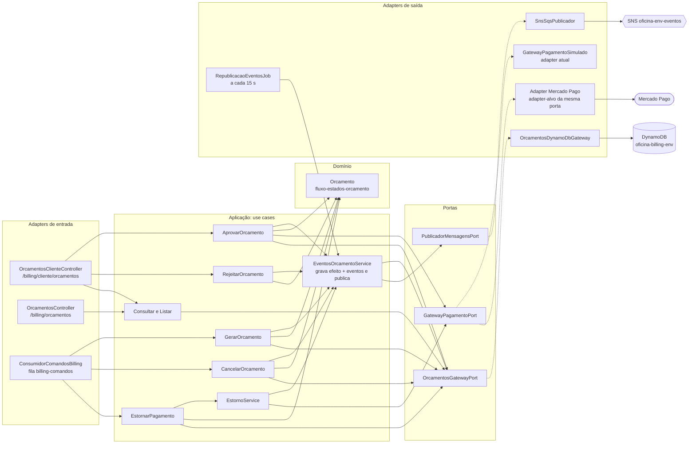
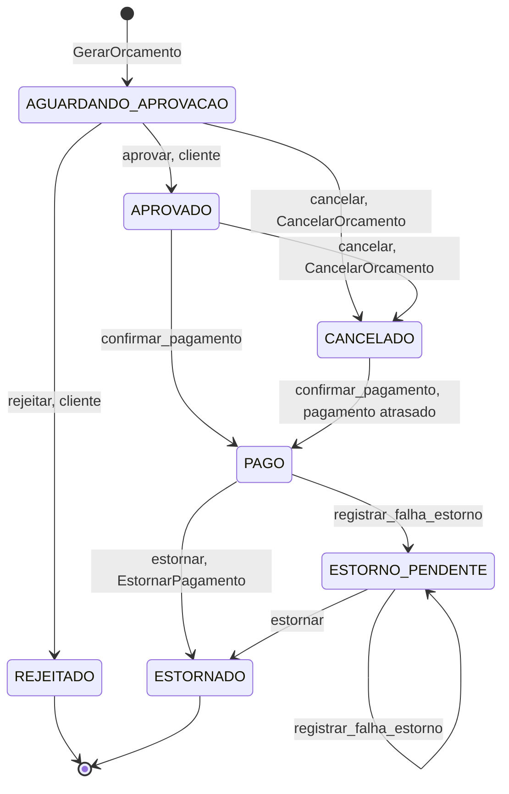

# Arquitetura — billing-service

O billing-service cuida do **orçamento** da ordem de serviço e do **pagamento** que o libera para o reparo. É um dos três microsserviços da Fase 4 (os outros são o os-service e o execution-service) e participa do fluxo da OS como **participante**: recebe comandos do orquestrador por SQS, aplica a regra de negócio no seu próprio banco (DynamoDB) e responde com eventos no tópico SNS. Nenhum outro serviço lê ou escreve na tabela do billing.

## 1. Responsabilidade

| O billing faz | O billing não faz |
| --- | --- |
| Gera o orçamento a partir do comando `GerarOrcamento` (valida que o total é a soma dos itens) | Decidir o rumo da OS: quem coordena os passos é o orquestrador do os-service |
| Expõe ao cliente a consulta, a aprovação e a rejeição do orçamento | Guardar cliente, veículo ou catálogo como fonte de verdade (recebe uma cópia no comando) |
| Cria a cobrança de pagamento quando o cliente aprova e devolve o `linkPagamento` | Executar diagnóstico ou reparo (execution-service) |
| Cancela o orçamento e estorna o pagamento quando o orquestrador compensa | Publicar evento sem antes gravá-lo junto do efeito (outbox, seção 7) |
| Publica o resultado de cada comando como evento (`OrcamentoGerado`, `OrcamentoCancelado`, `PagamentoEstornado` etc.) | |

Rotas, filas e mensagens completas estão em [`contratos/README.md`](../contratos/README.md).

## 2. Componentes (Clean Architecture)

Cada módulo segue as mesmas camadas do restante da solução: os *adapters* de entrada (controllers HTTP e consumidor SQS) chamam *use cases*; os use cases dependem apenas de **portas** (interfaces); os *adapters* de saída implementam essas portas.

Ligação das portas (`orcamentos.module.ts:38-39`): `ORCAMENTOS_GATEWAY` → `OrcamentosDynamoDbGateway` e `GATEWAY_PAGAMENTO` → `GatewayPagamentoSimulado`.

**Situação do pagamento.** O adapter de pagamento em uso hoje é o `GatewayPagamentoSimulado` (`gateway-pagamento.simulado.ts`): devolve um link `https://pagamento.simulado.local/checkout/<orcamentoId>`, guarda pagamentos e estornos em memória e não movimenta dinheiro. O **Mercado Pago (Checkout Pro) é o adapter-alvo da mesma `GatewayPagamentoPort`**, decisão registrada na [ADR 013](https://github.com/FIAP-POS-TECH-SOFTWARE-ARCHITECTURE/tc-oficina-os-service/blob/main/docs/arquitetura/adrs/adr-013-pagamento-antes-do-reparo-mercado-pago.md): trocá-lo não altera use cases nem domínio, só a classe ligada ao token `GATEWAY_PAGAMENTO`. A porta já declara as quatro operações que esse adapter precisa: `criarCobranca`, `consultarPagamento`, `buscarPagamentosPorOrcamento` e `estornar(pagamentoId, chaveIdempotencia)` (`gateway-pagamento.port.ts:51-57`).

## 3. Rotas

Todas passam pelo API Gateway com o prefixo `/billing` (o gateway não reescreve o caminho). Documentação Swagger em `/billing/docs`.

| Rota | Quem | Use case |
| --- | --- | --- |
| `GET /billing/cliente/orcamentos/:numeroOs` | cliente dono da OS | consultar |
| `POST /billing/cliente/orcamentos/:numeroOs/aprovar` | cliente dono da OS | aprovar: `422` fora de `AGUARDANDO_APROVACAO` ou com prazo vencido |
| `POST /billing/cliente/orcamentos/:numeroOs/rejeitar` | cliente dono da OS | rejeitar: `422` fora de `AGUARDANDO_APROVACAO` |
| `GET /billing/orcamentos/:numeroOs` | `ATENDENTE`, `ADMINISTRADOR` | consultar |
| `GET /billing/orcamentos?status=` | `ATENDENTE`, `ADMINISTRADOR` | listar por status |
| `GET /health` | pública, sem prefixo | probe do Kubernetes |
| `GET /health/ready` | pública, sem prefixo | readiness (consulta o DynamoDB) |

Origem no código: `orcamentos-cliente.controller.ts` (`@Controller("billing/cliente/orcamentos")`, linhas 18, 26, 33 e 41), `orcamentos.controller.ts` (`@Controller("billing/orcamentos")`, linhas 14, 21 e 28).

## 4. Máquina de estados do orçamento

Os sete estados e as seis transições vêm de `status-orcamento.ts` e `fluxo-estados-orcamento.ts`. Toda mudança passa por `Orcamento.transicionar`, que lança `TransicaoInvalidaError` se o estado de origem não está na lista da transição.

Observações, todas conferidas no código:

- **Estado inicial.** `Orcamento.criar` cria o orçamento em `AGUARDANDO_APROVACAO` com `versao = 1` (`orcamento.entity.ts:100`).
- **`CANCELADO → PAGO`.** Um pagamento que chega depois do cancelamento é registrado (campo `pagamentoAtrasado = true`, `orcamento.entity.ts:236-243`); o orquestrador então manda `EstornarPagamento`.
- **Cancelar depois de pago.** Se o orçamento já tem pagamento (`PAGO`, `ESTORNO_PENDENTE`, `ESTORNADO`), `CancelarOrcamento` não muda o status: o status reflete o dinheiro, e só registra `canceladoEm` e o motivo (`registrarCancelamentoSemMudarStatus`, `orcamento.entity.ts:225-233`). Em `REJEITADO` ou `CANCELADO` o comando só reemite o evento `OrcamentoCancelado`.
- **Transições sem ponto de entrada ainda.** `confirmar_pagamento` e `registrar_falha_estorno` existem no domínio (com testes unitários em `orcamento.entity.spec.ts`), mas nenhum use case as chama hoje: elas dependem do webhook e do adapter do Mercado Pago (seção 8) e do reagendamento de estorno (seção 9). Por isso `PagamentoConfirmado` e `EstornoFalhou` constam do catálogo de eventos do contrato, mas nenhum código de produção os emite ainda.

## 5. Modelo de dados: tabela única no DynamoDB

Uma tabela por ambiente, `oficina-billing-<env>` (`billing-dynamodb.tf` em `tc-oficina-infra-db`), chave primária `pk` (partição) + `sk` (ordenação) e um índice global `gsi1` (`gsi1pk`, `gsi1sk`, projeção `ALL`). O nome da tabela chega ao serviço pela variável `DYNAMODB_TABLE`. A tabela guarda sete tipos de item; cinco carregam o atributo `tipoItem` e os dois de deduplicação (`MSG#` e `WEBHOOK#`) só têm `processadaEm`.

| `tipoItem` | `pk` | `sk` | `gsi1pk` / `gsi1sk` | Para quê |
| --- | --- | --- | --- | --- |
| `ORCAMENTO` | `ORCAMENTO#<orcamentoId>` | `ORCAMENTO` | `STATUS#<status>` / `<criadoEm>#<orcamentoId>` | O orçamento (todos os campos do domínio, inclusive `versao`) |
| `PONTEIRO` | `OS#<osId>` | `ORCAMENTO` | — | Leva da OS ao `orcamentoId`; garante um orçamento por OS |
| `PONTEIRO` | `NUMERO_OS#<numeroOs>` | `ORCAMENTO` | — | Leva do número legível ao `orcamentoId` (rotas do cliente e da equipe) |
| `PAGAMENTO` | `ORCAMENTO#<orcamentoId>` | `PAGAMENTO#<pagamentoId>` | — | Pagamento conhecido pelo provedor, junto do orçamento |
| `EVENTO` | `EVENTO#<messageId>` | `EVENTO` | `EVENTO_PENDENTE` / `<ocorridoEm>#<messageId>` enquanto não publicado | Outbox: evento gravado na mesma transação do efeito |
| `—` | `MSG#<messageId>` | `MSG` | — | Mensagem de comando já processada (idempotência do consumidor) |
| `—` | `WEBHOOK#<pagamentoId>#<status>` | `WEBHOOK` | — | Notificação de pagamento já processada (idempotência do webhook) |
| `FLUXO_CANCELADO` | `FLUXO_CANCELADO#<fluxoId>` | `FLUXO` | — | Cancelamento que chegou antes do `GerarOrcamento` |

Fonte: `orcamentos.dynamodb.gateway.ts` — `chaveOrcamento` (linha 31), `itemOrcamento` (211-220), ponteiros em `criar` (93-105), `itensPagamentos` (244-257), `itensEventos` (259-278), `itensDedupe` (222-242), `registrarCancelamentoAntecipado` (143-165). O formato da chave `WEBHOOK#` (`<pagamentoId>#<status>`) está documentado no comentário de `EfeitosGravacao` (`orcamentos.gateway.ts:20-21`).

### Padrões de acesso

| Consulta | Como é feita |
| --- | --- |
| Orçamento por id | `GetItem` em `ORCAMENTO#<id>` / `ORCAMENTO`, leitura consistente |
| Orçamento por OS ou por número da OS | `GetItem` no ponteiro (`OS#...` ou `NUMERO_OS#...`) e depois no orçamento |
| Listar orçamentos por status | `Query` no `gsi1` com `gsi1pk = STATUS#<status>` (paginando); `gsi1sk` ordena por criação |
| Eventos a republicar | `Query` no `gsi1` com `gsi1pk = EVENTO_PENDENTE` e `gsi1sk < agora - 10 s`, no máximo 50 por rodada |
| Mensagem, notificação ou fluxo cancelado já visto | `GetItem` com leitura consistente na chave correspondente |

### Escritas transacionais e concorrência

Toda escrita de domínio usa **`TransactWriteItems`**: o efeito (orçamento, ponteiros, pagamentos), o registro de deduplicação (`MSG#` ou `WEBHOOK#`) e os eventos de saída entram ou saem juntos.

- **Criar** (`criar`, linhas 92-121): `Put` do orçamento e dos dois ponteiros com `attribute_not_exists(pk)` — uma segunda criação para a mesma OS falha com `OrcamentoJaExisteError`. Um `ConditionCheck` exige que não exista `FLUXO_CANCELADO#<fluxoId>`, para fechar a corrida com um cancelamento antecipado.
- **Atualizar** (`atualizar`, linhas 123-141): `Put` com `ConditionExpression: versao = :versaoAnterior` — escrita condicional por versão. Se duas operações leem a mesma versão, só a primeira grava; a outra recebe `ConflitoConcorrenciaError` (os use cases de aprovar e rejeitar transformam isso em `422`).
- **Mensagem duplicada:** se a condição do item de deduplicação falha, o gateway traduz para `MensagemJaProcessadaError` (`traduzir`, linhas 290-309) e o consumidor trata como já processada.

Na terminologia de transações distribuídas, a condição por `versao` é a contramedida de **reler o valor antes de atualizar** contra a anomalia de *lost update*: ninguém sobrescreve um orçamento que mudou entre a leitura e a escrita.

## 6. Mensagens

Contrato completo (envelope, atributos, catálogo, regras de idempotência e schemas): [`contratos/README.md`](../contratos/README.md).

| Sentido | Canal | Mensagens |
| --- | --- | --- |
| Consome | fila `oficina-<env>-billing-comandos` (DLQ `-dlq`) | `GerarOrcamento`, `CancelarOrcamento`, `EstornarPagamento` (`consumidor-comandos-billing.ts:31-40`) |
| Produz | tópico SNS `oficina-<env>-eventos`, `origem: billing` | `OrcamentoGerado`, `FalhaGerarOrcamento`, `OrcamentoAprovado`, `OrcamentoRejeitado`, `OrcamentoCancelado`, `PagamentoEstornado` (emitidos hoje); `PagamentoConfirmado`, `EstornoFalhou` (tipos declarados em `eventos-billing.ts:9-12`, sem emissor ainda) |

Comportamento do consumidor (`consumidor-sqs.ts`): long polling de 20 s, lote de até 10, validação do envelope contra os schemas do contrato e **exclusão da mensagem só depois** de o use case terminar sem erro (linha 101). Mensagem fora do contrato ou erro de processamento não apagam: a mensagem volta após o visibility timeout e, na quinta entrega, vai para a DLQ.

Respostas de cada comando:

| Comando | Evento de resposta |
| --- | --- |
| `GerarOrcamento` | `OrcamentoGerado`; `FalhaGerarOrcamento{motivo:"VALOR_TOTAL_INCONSISTENTE"}` se o total não bate; `FalhaGerarOrcamento{motivo:"ORCAMENTO_ENCERRADO"}` se já houve orçamento da OS e ele não está mais ativo; `OrcamentoCancelado{orcamentoId:null}` se o fluxo já tinha sido cancelado |
| `CancelarOrcamento` | `OrcamentoCancelado` (com `orcamentoId:null` quando o orçamento ainda não existe) |
| `EstornarPagamento` | `PagamentoEstornado` (com `pagamentoId:null` e `valorCentavos:0` quando não há pagamento a estornar) |

## 7. Idempotência e publicação confiável (outbox)

- **Consumidor idempotente.** Cada use case começa por `mensagemJaProcessada(messageId)` e grava o `MSG#<messageId>` na mesma transação do efeito. Reentrega da mesma mensagem não repete efeito nem evento. Quando o `messageId` é novo mas a ação já foi aplicada (por exemplo, cancelar um orçamento já cancelado), o billing registra o `messageId` e **reemite o evento de resultado**, para o orquestrador conseguir avançar.
- **Ordem não garantida.** O SQS Standard não ordena, então `CancelarOrcamento` pode chegar antes de `GerarOrcamento`. Nesse caso o billing grava `FLUXO_CANCELADO#<fluxoId>`, responde `OrcamentoCancelado` com `orcamentoId: null` e, quando o `GerarOrcamento` chegar, não cria orçamento (`cancelar-orcamento.use-case.ts:25-34`, `gerar-orcamento.use-case.ts:25-30`).
- **Outbox.** O evento é um item `EVENTO#` gravado na mesma transação do efeito. `EventosOrcamentoService` tenta publicar logo em seguida e, se publicar, remove o item do índice (`marcarEventoPublicado` faz `REMOVE gsi1pk, gsi1sk`). Se a publicação falhar, o `RepublicacaoEventosJob` varre `EVENTO_PENDENTE` a cada 15 s (`republicacao-eventos.job.ts:14`), com atraso mínimo de 10 s e lote de 50 (`eventos-orcamento.service.ts:15-16`). O trace distribuído é capturado uma vez e gravado junto do evento, e a republicação reenvia o mesmo contexto.

## 8. Webhook de pagamento

O contrato prevê `POST /billing/webhooks/mercado-pago` (pública, validada por `x-signature`): `200` para assinatura válida (inclusive notificação duplicada ou de tipo ignorado), `401` para assinatura inválida e `503` em falha temporária, para o provedor reenviar. O API Gateway já roteia essa rota e o `app.setup.ts` já a isenta do rate limit (`ROTAS_SEM_LIMITE`, linha 15).

O que existe hoje no serviço:

- **Persistência pronta para a idempotência do webhook.** `EfeitosGravacao.notificacaoProcessada` grava um item `WEBHOOK#<pagamentoId>#<status>` com `attribute_not_exists(pk)` na mesma transação do efeito (`orcamentos.dynamodb.gateway.ts:233-240`); notificação repetida vira `MensagemJaProcessadaError`, e `notificacaoJaProcessada` consulta a chave. Os pagamentos conhecidos entram como itens `PAGAMENTO#` na mesma transação.
- **Porta de consulta ao provedor.** `consultarPagamento` e `buscarPagamentosPorOrcamento` já existem na `GatewayPagamentoPort`, para a notificação ser confirmada junto ao provedor e para a reconciliação por `external_reference`.
- **Ainda não existe** o controller do webhook (nem a validação de `x-signature`), a rota de reconciliação, a chamada a `confirmarPagamento` e a emissão de `PagamentoConfirmado`. Eles chegam com o adapter do Mercado Pago, o adapter-alvo decidido na [ADR 013](https://github.com/FIAP-POS-TECH-SOFTWARE-ARCHITECTURE/tc-oficina-os-service/blob/main/docs/arquitetura/adrs/adr-013-pagamento-antes-do-reparo-mercado-pago.md).

## 9. Estorno e retentativa

`EstornarPagamento` (`estornar-pagamento.use-case.ts`) segue este caminho:

1. Mensagem já processada: sai sem efeito.
2. Orçamento sem pagamento ou já `ESTORNADO`: responde `PagamentoEstornado` imediatamente (com `pagamentoId: null` e valor `0` quando nunca houve pagamento), para o orquestrador não ficar preso compensando.
3. Caso normal: `EstornoService.estornar` chama `GatewayPagamentoPort.estornar(pagamentoId, "estorno-<orcamentoId>")`. A **chave de idempotência** faz o provedor devolver o mesmo estorno se a chamada se repetir (o adapter simulado reproduz esse comportamento, `gateway-pagamento.simulado.ts:40-41`). Em seguida o orçamento vai a `ESTORNADO` e `PagamentoEstornado` entra na outbox, tudo numa transação (`estorno.service.ts:18-27`).

Se o provedor falha, o erro sobe, a mensagem **não é apagada** e o SQS a reentrega depois do visibility timeout de 60 s; na quinta entrega ela vai para a DLQ `oficina-<env>-billing-comandos-dlq`. Além disso, o orquestrador reenvia a compensação sem resposta a cada prazo, com `messageId` novo, até três vezes, e depois marca o fluxo como falha técnica (ver [sequência de compensação](https://github.com/FIAP-POS-TECH-SOFTWARE-ARCHITECTURE/tc-oficina-os-service/blob/main/docs/arquitetura/sequencia-compensacao.md)).

O domínio já modela o estado `ESTORNO_PENDENTE`, com `tentativasEstorno`, `proximaTentativaEstornoEm` e `ultimoErroEstorno` (`orcamento.entity.ts:249-255`), e o contrato define o evento `EstornoFalhou{proximaTentativaEm}`. A retentativa agendada pelo próprio billing e a emissão desse evento ainda não estão ligadas: hoje a retentativa é a do SQS e a do orquestrador, descritas acima.

## 10. Papel no fluxo da OS

O fluxo da OS é coordenado por uma **Saga orquestrada** (Saga Pattern): um orquestrador central manda comandos e reage aos eventos de cada serviço, e desfaz o que já foi feito com compensações quando algo falha. No código, a Saga se chama `orquestracao-os`, o estado dela é o `FluxoOrdemServico` e o coordenador é o `OrquestradorOrdemServico`, todos no os-service. O billing é **participante**, sem lógica de orquestração.

| Passo da Saga | Comando que o billing recebe | Efeito | Evento |
| --- | --- | --- | --- |
| Gerar orçamento | `GerarOrcamento` | cria o orçamento em `AGUARDANDO_APROVACAO` | `OrcamentoGerado` / `FalhaGerarOrcamento` |
| Compensar: desfazer o orçamento | `CancelarOrcamento` | `AGUARDANDO_APROVACAO` ou `APROVADO` → `CANCELADO` | `OrcamentoCancelado` |
| Compensar: devolver o dinheiro | `EstornarPagamento` | `PAGO` → `ESTORNADO` (sem pagamento registrado, só reemite `PagamentoEstornado` com `pagamentoId` nulo) | `PagamentoEstornado` / `EstornoFalhou` (este último ainda não emitido) |

A aprovação e a rejeição acontecem por HTTP, pelo cliente, e viram os eventos `OrcamentoAprovado` e `OrcamentoRejeitado`, que o orquestrador consome para avançar. O pagamento é o último passo antes do reparo (contramedida de *visão pessimista*: o reparo só começa com o dinheiro já confirmado).

Para o conjunto da solução, ver no os-service a [visão geral](https://github.com/FIAP-POS-TECH-SOFTWARE-ARCHITECTURE/tc-oficina-os-service/blob/main/docs/arquitetura/visao-geral-microsservicos.md), a [sequência do fluxo da OS](https://github.com/FIAP-POS-TECH-SOFTWARE-ARCHITECTURE/tc-oficina-os-service/blob/main/docs/arquitetura/sequencia-fluxo-os.md), a [sequência de compensação](https://github.com/FIAP-POS-TECH-SOFTWARE-ARCHITECTURE/tc-oficina-os-service/blob/main/docs/arquitetura/sequencia-compensacao.md) e a [ADR 008 (Saga orquestrada)](https://github.com/FIAP-POS-TECH-SOFTWARE-ARCHITECTURE/tc-oficina-os-service/blob/main/docs/arquitetura/adrs/adr-008-saga-orquestrada.md).
